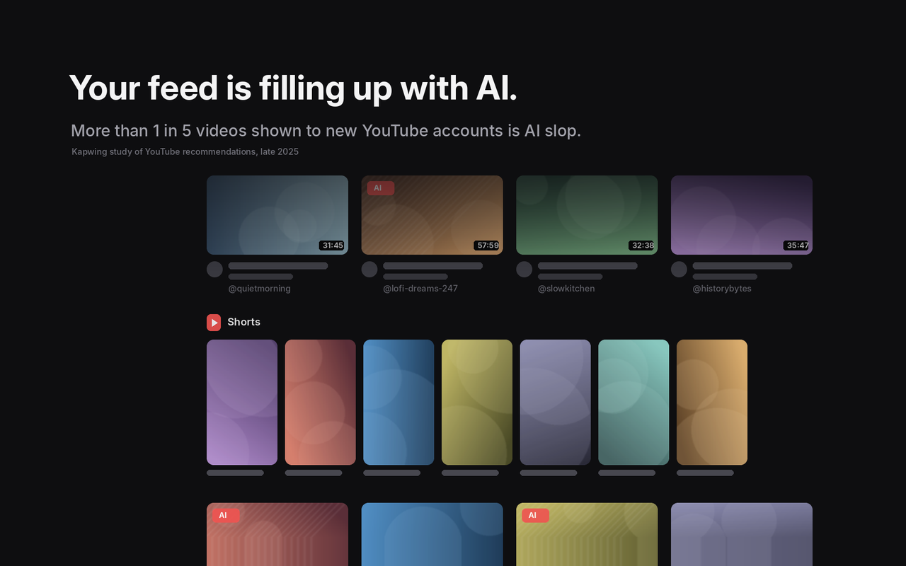
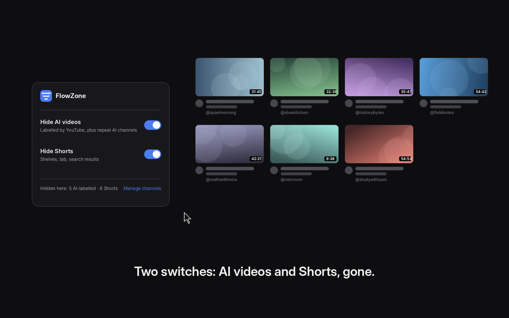
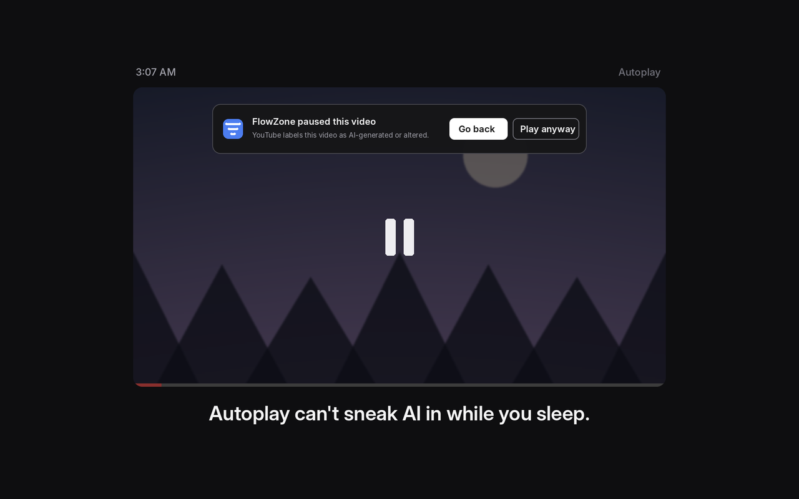
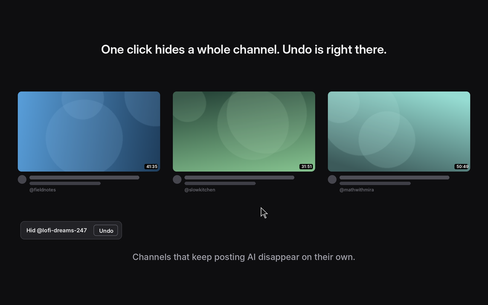

# FlowZone

**Your OG YouTube, back.** Hides AI videos, AI channels and Shorts.

&nbsp;

 

<table>
  <tr>
    <th width="50%">Before</th>
    <th width="50%">With FlowZone</th>
  </tr>
  <tr>
    <td></td>
    <td></td>
  </tr>
</table>

## Tell us what to build

Search the [open issues](https://github.com/rigspark/flowzone-support/issues) first. If someone already asked, add a 👍: we build the most-wanted ideas first.

<table>
  <tr>
    <td width="33%" valign="top">
      <h3>💡 Feature request</h3>
      An idea or a change to how FlowZone works.  
      <a href="https://github.com/rigspark/flowzone-support/issues/new?template=feature_request.yml"><b>Suggest an idea →</b></a>
    </td>
    <td width="33%" valign="top">
      <h3>📺 Channel report</h3>
      An AI channel it misses, or a real creator it hides by mistake.  
      <a href="https://github.com/rigspark/flowzone-support/issues/new?template=channel_report.yml"><b>Report a channel →</b></a>
    </td>
    <td width="33%" valign="top">
      <h3>🐞 Bug report</h3>
      Something isn't working as described.  
      <a href="https://github.com/rigspark/flowzone-support/issues/new?template=bug_report.yml"><b>Report a bug →</b></a>
    </td>
  </tr>
</table>

## Roadmap

| 🔥 Most wanted | 🗓️ Planned | ✅ Shipped |
| --- | --- | --- |
| [Open requests by 👍](https://github.com/rigspark/flowzone-support/issues?q=is%3Aissue%20is%3Aopen%20sort%3Areactions-%2B1-desc) | [Issues labelled `planned`](https://github.com/rigspark/flowzone-support/issues?q=is%3Aissue%20label%3Aplanned) | [Issues labelled `shipped`](https://github.com/rigspark/flowzone-support/issues?q=is%3Aissue%20label%3Ashipped) |

## What FlowZone does

<table>
  <tr>
    <td width="33%" valign="top"><b>Hide AI videos</b> Anything YouTube labels as AI-generated or altered, in your feed, search, suggestions and channel pages.</td>
    <td width="33%" valign="top"><b>AI channels disappear</b> Once a channel has posted two videos YouTube labels as AI, the rest of it goes too.</td>
    <td width="33%" valign="top"><b>No Shorts</b> Shelves, the Shorts tab, the search filter and Shorts in search. Shorts links open in the normal player.</td>
  </tr>
  <tr>
    <td valign="top"><b>Autoplay guard</b> Land on, or autoplay into, a video FlowZone would hide, and it pauses and asks: Go back, or Play anyway.</td>
    <td valign="top"><b>One-click hide</b> Hover any video and press ⊘ to hide its whole channel. Undo is right there.</td>
    <td valign="top"><b>Never hide</b> Keep the channels you trust visible, whatever the filters say.</td>
  </tr>
  <tr>
    <td colspan="3" valign="top"><b>Catch unlabelled AI</b> (optional, off by default): also hides videos whose titles name AI video tools such as Sora, Veo, Kling or Seedance, or say they're AI-generated.</td>
  </tr>
</table>

<table>
  <tr>
    <td width="50%"></td>
    <td width="50%"></td>
  </tr>
</table>

## Good to know

<b>Why is an AI video still showing?</b>

 
FlowZone hides what YouTube itself labels as AI, plus channels that keep posting it and any channel you block. YouTube labels realistic AI content, but not most animated AI, so some slips through. Press ⊘ to hide that channel, turn on <b>Catch unlabelled AI</b>, or <a href="https://github.com/rigspark/flowzone-support/issues/new?template=channel_report.yml">report the channel</a>.

<b>Does it work in the YouTube app or on a TV?</b>

 
Not yet. FlowZone works on youtube.com in Chrome on your computer. Want it somewhere else? <a href="https://github.com/rigspark/flowzone-support/issues/new?template=feature_request.yml">Ask for it</a>.

<b>Is it an ad blocker?</b>

 
No. FlowZone only hides AI videos, AI channels and Shorts. It doesn't touch ads.

<b>How do I back up my channel lists?</b>

 
Open <b>Manage channels</b> from the FlowZone popup. Your lists are plain text, so you can copy them out, back them up or share them.

## Private by design

✅ No accounts &nbsp;·&nbsp; ✅ No servers &nbsp;·&nbsp; ✅ No tracking &nbsp;·&nbsp; ✅ Free

Your settings and lists stay in your Chrome profile. To read YouTube's own AI label, FlowZone asks youtube.com for the video's public data, signed out, and sends nothing anywhere else. Read the [privacy policy](https://www.rigspark.si/flowzone/privacy/).

Everything in this repo is public, so please keep personal information out of issues.

---

**Built with [RigSpark](https://www.rigspark.si)** 
Made by one engineer and Byte, the RigSpark coder. Commits are co-authored by rigspark[bot].

[How we triage issues](CONTRIBUTING.md) · [MIT License](LICENSE)

